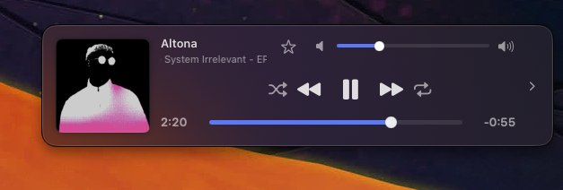

# Cue

A floating control panel for Apple Music on macOS.

macOS 27 shrank Music.app's playback controls into a thin strip at the bottom of
the window. Cue puts them back, in a small window that floats above whatever
you're working on: a scrub bar wide enough to land on the right second, track
info you can read, and transport buttons you don't have to aim at.

<!-- TODO: add docs/screenshot.png and uncomment

-->

```
┌─────────────────────────────────────────────────────────┐
│  ┌─────────┐  Title                  🔈 ━━━━━━━━━━ 🔊    │
│  │         │  Artist — Album                             │
│  │   art   │       ⇄   ⏮    ⏯    ⏭   ↻                   │
│  │         │  1:42 ━━━━━━━━●───────────────   -2:13      │
│  └─────────┘                                             │
└─────────────────────────────────────────────────────────┘
```

Cue doesn't play anything itself. It drives the Music app, so your library,
subscription, downloads and AirPlay routing all keep working exactly as they do
now — you're just steering from a better seat.

## Requirements

- **macOS 27 or later.** This is deliberate rather than lazy: before macOS 27,
  Music's own controls were fine and you didn't need this.
- Apple Silicon.
- The Music app.

## Install

1. Download `Cue.zip` from [Releases](../../releases/latest).
2. Unzip it and drag **Cue.app** to your Applications folder.
3. Open it.

The build is signed with a Developer ID and notarised by Apple, so it opens
normally — no right-click-to-open, no Gatekeeper warning.

Cue has no Dock icon. It lives in the menu bar, under a ⏯ icon.

### The permission prompt

The first time Cue talks to Music, macOS will ask whether Cue may control it.
**Click OK** — without it, Cue can see and do nothing.

Cue controls Music through the same public AppleScript interface that Automator,
Shortcuts and a decade of Mac utilities use. That prompt is macOS telling you one
app wants to automate another, which is exactly what's happening. Cue uses no
private frameworks, talks to no network, and is sandboxed out of everything else.

To change your mind later: **System Settings → Privacy & Security → Automation →
Cue**.

## Using it

| | |
|---|---|
| **Scrub** | Drag anywhere along the progress bar. Click to jump. |
| **Move the panel** | Drag it anywhere — the artwork, the title, the background. |
| **Resize** | Drag either side edge. Width only; the height is fixed by design. |
| **Collapse** | The chevron on the right edge folds the panel down to just its album art. Click it again to expand. |
| **Volume** | This is *Music's* volume, not your system volume. Scroll over the slider for fine adjustment; the left speaker icon mutes and unmutes. |
| **Favourite** | The star, at wider panel sizes. |
| **Shuffle and repeat** | Either side of the transport buttons. Repeat cycles off → all → one. |

The panel never takes keyboard focus. Click a button on it and your keystrokes
still go to whatever you were typing in.

From the menu bar icon:

- **Show/Hide Panel**
- **Always on Top** — on by default. Turn it off and Cue behaves like an ordinary
  window, dropping behind others.
- **Launch at Login**
- **Quit**

Changes you make in Music show up in Cue within a second, and vice versa.

## What it doesn't do

- **Other players.** Music only. Spotify and browser audio would need private
  frameworks, which this app doesn't use.
- **AirPlay device switching.** Left to Music on purpose — macOS routes audio
  perfectly well without another app in the middle.
- **Lyrics and Up Next.** Music doesn't expose either to other apps.

## Building from source

Requires Xcode 27 and a Developer ID signing identity (debug builds are signed
too — the macOS Automation grant is tied to a code signature, so an ad-hoc
signature makes the permission prompt come back on every build).

```sh
xcodebuild -project Cue.xcodeproj -scheme Cue -configuration Release build
```

To produce a notarised zip, with a stored `notarytool` credential profile:

```sh
CUE_NOTARY_PROFILE=YourProfileName ./tools/sign-and-notarise.sh
```

`CLAUDE.md` is the project's working specification — architecture, decisions, and
a long list of things that turned out not to work. Worth reading before changing
anything.

## Licence

MIT. See [LICENSE](LICENSE).

Not affiliated with, endorsed by, or connected to Apple. "Apple Music" and
"Music" are trademarks of Apple Inc.
